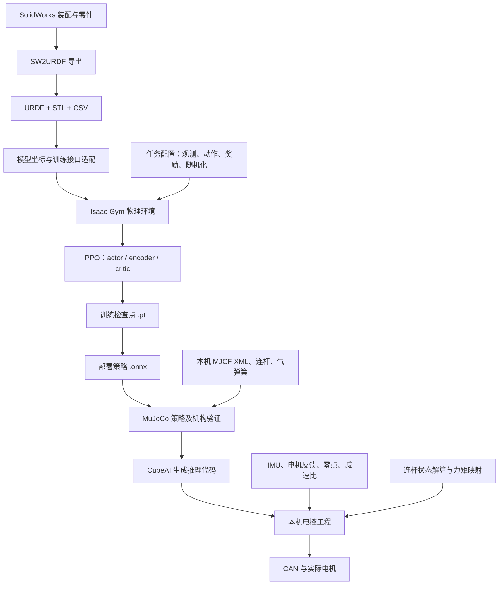

# 轮腿机器人：文件关系、模型修复记录与训练部署实施说明

核对日期：2026-10-27。项目根目录：`D:\robomaster_material\electric_contol\zhongzhuang`。

本文回答四件事：现有文件分别做什么、它们如何连接、带网格 URDF 是怎样修复的、下一阶段哪些工作可以由助手完成以及如何验收。文中的“已完成”以当前文件与备份核对为准；“计划”不是已经实现的代码。

## 1. 当前结论与工作范围

目前已有一份包含真实 STL、质量、质心、惯量及六个活动关节的模型：`solidwork_graph/fourth_version_with_meshes`。它已经从“六个关节全部固定”修正为“四个腿关节旋转、两个轮关节连续旋转”。更晚一次导出的 `solidwork_graph/fifty_version_with_meshes` 也已按同样方式修复，并把关节名对齐复旦训练命名，详见 5.7。

**这代表结构与转轴的静态修复已完成，不代表已经完成 Isaac Gym 加载、稳定站立、PPO 训练或实机部署。**

当前六个自由度足以匹配复旦简化轮腿策略的接口：左右大腿、左右小腿、左右轮。训练观测中的“四个角度＋六个角速度”来自这同一组六个关节，不需要增加到十个关节。

本轮文档承接以下范围：

- 首先完成站立、低速前后移动、低速转向，再考虑跳跃、台阶和自救。
- 使用六关节简化腿进行第一阶段训练；详细连杆与气弹簧在后续动力学验证中补齐。
- 当前云台并入机身，不具有独立 yaw/pitch 自由度。这只是现有模型状态；如果恢复之前提出的 yaw/pitch 运动需求，需要单独扩展模型和控制接口，不能直接塞进现有六维策略。
- 现有质量和惯量按用户要求作为输入依据保留；数学合法不等于已经通过称重或实验校准。
- 软件安装或下载前先说明；实物烧录、电机运行和实机测试需要另行明确授权。

### 1.1 当前状态表

| 工作 | 状态 | 当前证据或边界 |
|---|---|---|
| 带网格模型的六个活动关节 | 已完成静态修复 | 当前 URDF、CSV、修复报告及原文件备份 |
| 网格文件完整性及保持不变 | 已检查 | 7 个二进制 STL；SHA256 与修复报告一致 |
| 关节转轴与非零角度运动 | 已完成数学检查 | 六关节分别以 0.2 rad 测试网格顶点运动 |
| 带网格版质量、质心、惯量及初始装配位置保留 | 已核对 | 当前与备份的全部 link XML 一致；各 joint/origin 一致 |
| 带网格版转换为复旦训练坐标与命名 | 待实施 | 当前仍是 SW 坐标、旧名称与旧零位 |
| fifty_version_with_meshes 的六个活动关节 | 已完成静态修复 | 结构同 fourth 版；关节名已对齐 fudan，坐标与零位仍是 SW 原始值；见 5.7 |
| 简化几何版本的训练适配入口 | 已写，未运行 Isaac Gym | 位于另一个目录 `fourth_version/integration` |
| 教师辅助迁移训练 | 待实现 | `process.md` 为方案；当前未找到 `wheel_legged_custom` 任务目录 |
| Isaac Gym 加载、接触、站立验证 | 未完成 | 尚未在指定训练环境运行 |
| 本机对应的 MuJoCo 连杆模型 | 未建立 | 项目内 XML 仍是参考机器人模型 |
| 本机对应的连杆解算、气弹簧标定 | 待实施 | 需要核对本机几何与硬件参数 |
| 本机 CubeAI 推理和固件接入 | 待实施 | 部署仓库是参考实现，不能当成完整固件直接烧录 |

## 2. 总体文件关系



两条闭环应分开理解：

```text
训练闭环：
仿真状态 → 25维观测与125维历史 → 策略动作 → PD力矩 → 仿真器
                    ↑                         ↓
                  PPO更新 ← 奖励与下一状态

实机闭环：
IMU/电机反馈 → 坐标和连杆解算 → 同样的观测 → 已训练策略
      ↑                                      ↓
实际运动 ← 电机输出 ← 限幅/气弹簧补偿/力矩映射 ← PD
```

URDF 提供物理结构；神经网络负责根据状态选择动作；部署算法负责使仿真中的状态和动作在真实机构中具有相同含义。三者不能互相替代。

## 3. 目录与文件职责

以下相对路径均从本文所在的 `zhongzhuang` 目录开始。带链接的文件可直接查看；目录树中的文件名用于描述关系。

### 3.1 模型目录：solidwork_graph

```text
solidwork_graph/
├─ first_version/、second_version/、third_version/  历史导出版本
├─ fourth_version/                               已转换的简化几何版本
│  ├─ urdf/fourth_version.urdf
│  ├─ urdf/fourth_version.csv                     修改前 SW 导出配置，未跟随坐标转换重写
│  ├─ config/model_parameters.json                坐标变换、默认角、代理尺寸、验证记录
│  ├─ config/joint_names_fourth_version.yaml
│  ├─ config/installation_manifest.json
│  ├─ integration/fudan_train.py                  简化版独立训练接入与检查入口
│  ├─ integration/validate_model.py               无第三方依赖的静态验证
│  ├─ MODEL_NOTES.md
│  └─ backups/                                   修改前文件
├─ fourth_version_with_meshes/                    当前真实外观模型
   ├─ urdf/fourth_version_with_meshes.urdf
   ├─ urdf/fourth_version_with_meshes.csv
   ├─ meshes/
   │  ├─ base_link.STL
   │  ├─ r0_link.STL、r1_link.STL、right_wheel.STL
   │  └─ l0_link.STL、l1_link.STL、left_wheel.STL
   ├─ config/joint_names_fourth_version_with_meshes.yaml
   ├─ config/display.rviz
   ├─ config/joint_fix_report.json
   ├─ launch/display.launch
   ├─ launch/gazebo.launch
   ├─ package.xml、CMakeLists.txt
   ├─ export.log
   ├─ JOINT_FIX_NOTES.md
   └─ backups/before_joint_fix_20261027_141545/
└─ fifty_version_with_meshes/                     更新的真实外观模型，已做同类关节修正
   ├─ urdf/fifty_version_with_meshes.urdf
   ├─ urdf/fifty_version_with_meshes.csv
   ├─ meshes/                                     7 个 STL，文件名与 fourth 版不同
   ├─ config/joint_names_fifty_version_with_meshes.yaml
   ├─ config/display.rviz
   ├─ config/joint_fix_report.json
   ├─ launch/display.launch、launch/gazebo.launch
   ├─ package.xml、CMakeLists.txt、export.log
   ├─ JOINT_FIX_NOTES.md
   ├─ tools/fix_fifty_joints.py                   本次修复与校验脚本，不可对已修复模型重复运行
   └─ backups/before_joint_fix_20261027_224822/
```

同级的 `fifty_version_with_meshes copy/` 与修复前的 `fifty_version_with_meshes` 逐字节相同，作为原始 SW 导出对照保留，未做修改。

| 文件 | 输入/输出及用途 | 不负责什么 |
|---|---|---|
| [带网格 URDF][mesh-urdf] | 定义 link、joint、质量、质心、惯量、外观与碰撞几何引用 | 不存储实时关节角速度，不执行策略推理 |
| [导出 CSV][mesh-csv] | 记录 SW 选件、坐标系名称、轴名称及导出参数；帮助追溯零件归属 | 不是训练数据集，也不能自动替代 SW 内部保存的插件配置 |
| 7 个 STL | 描述各 link 局部坐标系中的三角网格；当前也被用于 collision | 不包含关节连接和转轴定义；不提供完整的物理材料模型 |
| [关节 YAML][mesh-yaml] | 记录本包关节名称列表 | 不创建关节，也不保证 Isaac Gym 的实际自由度加载顺序 |
| [display.launch][mesh-display] + [display.rviz][mesh-rviz] | 用 ROS 1 的 joint_state_publisher_gui、robot_state_publisher 和 RViz 查看模型 | RViz 展示关节运动，不是完整动力学仿真 |
| gazebo.launch | 原导出器的 Gazebo 模型生成入口 | 不等于完整电机控制器或复旦训练入口；本次未运行验证 |
| package.xml / CMakeLists.txt | ROS 1 包元数据、构建和安装资源描述 | 不设置强化学习奖励或神经网络 |
| export.log | SW2URDF 导出过程的历史记录 | 修复后不会自动重写历史日志 |
| [joint_fix_report.json][mesh-report] | 记录修复轴向、网格哈希、三角形数、顶点运动检查及备份路径 | `runtime_tested=false` 明确表示未运行物理仿真 |
| [JOINT_FIX_NOTES.md][mesh-notes] | 此模型的局部修复说明 | 不代表训练迁移已全部完成 |

**两份 fourth_version 不能混用：**

| 对比 | fourth_version | fourth_version_with_meshes |
|---|---|---|
| 外观/碰撞 | 长方体、圆柱代理几何 | 真实导出 STL |
| 轮半径 | 暂定 0.075 m | 来自现有网格；轮组是否完整仍需实物核对 |
| 名称与零位 | 已按复旦简化训练约定转换 | 仍保留 SW 导出名称、坐标及零位 |
| 质量 | 约 25.69460515 kg | 约 25.69460532 kg；来自稍后一次导出 |
| 独立训练接入脚本 | 已有，尚未运行验证 | 尚未创建匹配这一版的训练适配 |
| 主要用途 | 低成本结构与接口检查 | 真实外观模型与后续训练模型的来源 |

不能把带网格 URDF 直接覆盖进简化版目录，然后继续沿用简化版的 `model_parameters.json`。文件名相似不表示关节坐标约定相同。

此前提供过的 CAD 路径是 `D:\robomaster_material\electric_contol\zhongzhuang\solidwork_graph\26英雄整车总装.STEP`。**本次文档核对时，该路径已不存在，在 solidwork_graph 下也未检出 STEP/SLDASM。** 这不影响读取已有 URDF/STL，但精确重建连杆机构前需要重新定位完整装配或 STEP。本文不把该历史路径作为现存文件链接。

### 3.2 训练目录：ref_document/fudan_rl_wheel_leg-main

```text
fudan_rl_wheel_leg-main/
├─ process.md                          既有迁移训练方案；不是全部已实现的功能
├─ explain.md                          工程说明参考
├─ plane/                              第一阶段站立/行走的训练主线
│  ├─ setup.py
│  ├─ resources/robots/
│  │  ├─ hero_2_V1/urdf/hero_2_V1.urdf           用户最初参考的模型
│  │  └─ infantry_V4/urdf/infantry_V4_increase.urdf  当前原任务默认模型
│  ├─ wheel_legged_gym/
│  │  ├─ scripts/train.py
│  │  ├─ scripts/play.py、play_export.py、export_encoder_jit.py
│  │  ├─ envs/__init__.py
│  │  ├─ envs/base/legged_robot.py
│  │  ├─ envs/base/legged_robot_config.py
│  │  ├─ envs/wheel_legged/wheel_legged_config.py
│  │  ├─ utils/task_registry.py、helpers.py
│  │  └─ rsl_rl/
│  │     ├─ runners/on_policy_runner.py
│  │     ├─ algorithms/ppo.py
│  │     ├─ modules/actor_critic_sequence.py
│  │     └─ storage/rollout_storage.py
│  ├─ logs/                            训练输出位置；不能仅凭目录存在判断有有效模型
│  └─ export_onnx/                     导出相关目录；使用前核对实际文件和接口
├─ jump/                               独立的跳跃训练分支，不是本阶段首选入口
└─ mujoco/                             策略推理与 sim2sim 验证
```

**注意实际 PPO 代码位于 `plane/wheel_legged_gym/rsl_rl/`，不是 `plane/rsl_rl/`。**

| 文件 | 具体职责 | 与下一层的关系 |
|---|---|---|
| [train.py][train] | 创建环境、创建训练 runner、启动 learn | 调用 task_registry |
| [envs/__init__.py][env-reg] | 注册任务名称、环境类、配置类 | 原任务名为 wheel_legged；后续新增自定义任务而不是覆盖原任务 |
| [task_registry.py][registry] | 根据任务和参数创建环境、算法 runner，管理配置/日志/恢复 | 接入 LeggedRobot 和 OnPolicyRunner |
| [wheel_legged_config.py][train-cfg] | 当前机器人的 URDF 路径、默认关节角、PD、腿长等 | 决定同一个算法在什么机器人上运行 |
| [legged_robot_config.py][base-cfg] | 观测维度、奖励系数、随机化、仿真步长等基础配置 | 被具体任务配置继承 |
| [legged_robot.py][env] | 加载机器人、读取状态、拼接观测、动作转力矩、步进、奖励与重置 | 与 Isaac Gym 物理仿真交互 |
| [on_policy_runner.py][runner] | 组织采样、学习迭代、保存/加载网络 | 调用 PPO 与策略网络 |
| [ppo.py][ppo] | PPO 更新，使用轨迹计算并优化训练目标 | 从 storage 读取样本并更新网络参数 |
| [actor_critic_sequence.py][policy-net] | encoder 处理历史；actor 输出动作；critic 评估训练状态 | 部署通常需要 actor 和 encoder，不需要完整训练用 critic |
| [rollout_storage.py][storage] | 保存观测、动作、奖励、值估计等轨迹数据 | 为 PPO 更新提供批次 |
| [play.py][play] | 加载策略评估和观察运动 | 不负责从 SW 创建模型 |
| [play_export.py][play-export] | 播放并调用现有导出工具 | 当前调用 export_policy_as_jit；不能仅凭文件名假定已导出需要的双输入 ONNX |
| [helpers.py][helpers] | 参数处理、配置辅助、导出工具等 | 需要针对最终部署接口核对导出路径 |
| [process.md][process] | 既定的权重恢复、教师辅助 PPO、独立 PPO、分段续训方案 | 很多新脚本和命令仍属于待实现设计 |

当前原任务默认使用 `infantry_V4_increase.urdf`，而不是最初讨论的 `hero_2_V1.urdf`。参考模型、训练默认模型、MuJoCo 默认模型可能不是同一台机器人，不能互相混用质量、腿长和零位。

### 3.3 MuJoCo 文件

| 文件 | 职责 |
|---|---|
| [onnx_mj_chuanlian.py][mj-serial] | 串联简化模型的 ONNX 仿真参考入口；接入本机前仍需核对具体接口 |
| [onnx_mj_binglian.py][mj-parallel] | 并联连杆模型推理、虚拟关节状态与实际驱动力矩映射、气弹簧施力等 |
| [infantry_V2/meshes/mjmodel.xml][mj-xml] | 参考车的 MJCF 场景，描述刚体、关节、碰撞、执行器、闭环连接、气弹簧端点 |
| [上台阶3_angz+.onnx][teacher] | 既有迁移计划选用的教师候选；不是为本机训练过的模型 |

并联 Python 默认加载上述 infantry_V2 XML。XML 中用 `equality/connect` 连接闭环，用两个安装点之间的 `spatial tendon` 表达气弹簧的作用路径，Python 对对应执行器施力。当前参考代码的气弹簧控制值及补偿系数属于参考车参数，不可直接认作本机标定值。

### 3.4 部署参考目录：XYEGA_RM2026_WheelLeg_Infatry_RLdeploy-main

```text
XYEGA_RM2026_WheelLeg_Infatry_RLdeploy-main/
├─ readme.md
├─ pseudocode/
│  ├─ math_core.hpp、math_core.cpp
│  ├─ policy_params_design.hpp
│  ├─ rl_policy_design.hpp、rl_policy_design.cpp
│  ├─ main_loop_design.cpp
│  └─ example/onnx/                    Stable / Upstairs / Spin / Jump 等参考网络
└─ source_code/User/
   ├─ Application/chassis/
   │  ├─ chassis.cpp、chassis.h
   │  └─ chassis_types.h、chassis_uitils.h
   ├─ Module/rl_policy/rl_policy.cpp、rl_policy.h
   ├─ Module/leg_solver/leg_solver.cpp、leg_solver.h
   └─ Task/robot_task/
```

| 文件 | 具体职责 |
|---|---|
| [部署 readme][deploy-readme] | 描述整体方案及限制；明确不是可独立编译的完整工程 |
| [math_core.cpp][math-core] / [math_core.hpp][math-header] | 连杆解算、雅可比、虚拟关节状态、观测、动作到力矩的数学参考实现 |
| [policy_params_design.hpp][policy-params] | 每个参考策略的默认角、PD、缩放参数表 |
| [main_loop_design.cpp][main-loop] | 传感器读入、100 Hz 推理与 500 Hz 执行的调度示意；硬件读写部分需要接入 |
| rl_policy_design.hpp/cpp | CubeAI 推理封装的示意版本 |
| [chassis.cpp][chassis] / [chassis.h][chassis-h] | 实车源码快照中的状态获取、虚拟腿解算、观测、策略控制与输出仲裁 |
| [rl_policy.cpp][cubeai] / rl_policy.h | 生成网络的初始化、25/125 维输入拷贝、6 维输出读取 |
| [leg_solver.cpp][leg-solver] | 通用虚拟腿运动学、雅可比、力/位置控制模块；RL 专用流程还在 chassis.cpp 中 |

同一数学流程同时出现在伪代码和源码快照中，不能把两个目录当成两套要同时调用的控制器。先用纯数学参考明确接口，再把匹配本机的实现接到实际固件中。

`ref_document` 下还存在 `chassis_of_hero`、`chassis_ref_new`、`chassis_ref_origin`、`HKU_Balancing_2026` 等目录。本文不把任何一个自动指定为最终烧录工程；后续需要确认实际使用的 MCU、完整固件路径、驱动和反馈接口。

## 4. 从模型到策略，再到电机的数据定义

### 4.1 三个“原点”不要混淆

- `joint/origin`：父 link 到子 link 在关节零位时的参考变换，决定轴心位置和参考方向。
- `inertial/origin`：质心及惯性坐标系相对 link 的位置和方向。
- `visual/origin` / `collision/origin`：网格相对 link 的位置和方向。

修改关节坐标系后，如果不同时考虑网格和惯性变换，就可能造成外形错位或惯量方向错误。本次带网格修复没有改 joint/origin，因此原装配外形无需重新变换。

### 4.2 策略输入：25 + 125

| 当前观测索引 | 内容 | 来源 |
|---|---|---|
| 0–2 | 机身角速度，参考缩放 0.25 | 仿真刚体状态；实机 IMU |
| 3–5 | 投影重力方向 | 仿真姿态；实机姿态四元数 |
| 6–8 | 前进速度、转向速度、高度指令，经过缩放 | 任务采样；实机遥控/上层指令 |
| 9–12 | 四个腿关节相对默认角的偏差 | 仿真关节；实机连杆解算后的等效关节 |
| 13–18 | 六个关节角速度，参考缩放 0.05 | 仿真状态或其差分；实机反馈和速度雅可比 |
| 19–24 | 上一步策略动作 | 控制器保存 |

另外堆叠五帧观测，共 125 维历史。需要统一采样时刻、帧顺序、初始化和重置方式；仅维度相同不代表含义相同。

轮子有速度观测但不使用累计旋转角度，故不是缺少两个角度传感器，也不是缺少两个关节。机身姿态属于浮动基座状态，不需要为 IMU 再增加三个电机关节。

### 4.3 策略输出与最终训练目标

复旦接口顺序为：

```text
[左大腿位置动作, 左小腿位置动作, 左轮速度动作,
 右大腿位置动作, 右小腿位置动作, 右轮速度动作]
```

按当前训练主线：

```text
腿部：q_target = q_default + 0.5 * action
轮子：qd_target = 10 * action
力矩：tau = Kp * (q_target - q) + Kd * (qd_target - qd)
```

腿部速度目标为零以形成阻尼；轮部 Kp 为零，主要通过速度误差产生力矩。神经网络输出不是六个电机的直接角度命令，也不是六个已经换算完成的 N·m 数值。

PPO 优化的是速度/转向/高度跟踪、控制代价等累计奖励。训练不是把某组人工标注的“正确关节角”作为唯一监督答案。

### 4.4 实机的两次映射

第一条是状态映射：

```text
电机编码器原始角/速度
 → 安装偏置、减速比与正方向
 → 连杆正运动学和速度雅可比
 → 与 URDF 相同含义的 q、qd
 → 25维观测与125维历史
```

第二条是执行映射：

```text
策略动作 → PD虚拟关节力矩 → 连杆力矩映射
         → 气弹簧补偿及限制 → 物理电机通道 → 驱动命令
```

若实际电机坐标为 m，策略对应的等效关节坐标为 q，则统一定义后：

```text
q = f(m)
qd = J(m) * mdot
tau_motor = transpose(J(m)) * tau_virtual
```

该力矩关系来自虚功一致性。气弹簧、摩擦、驱动效率等作用需要按选定模型另外处理。

参考代码的虚拟小腿角由两个驱动电机共同决定。例如左侧使用 `phi3 - phi4 - pi/2`，速度使用相应偏导与两电机速度的乘积求和；执行时虚拟小腿力矩也会分配到两个驱动电机。不能把“左小腿动作”直接当成“左小腿驱动电机的编码器目标角”。

参考程序的策略顺序与实际 CAN 通道顺序并不相同，轮速和轮力矩还存在显式符号变换。应按本机编码器和力矩正方向核对，不能仅凭变量名字接线。

## 5. 带网格版本具体怎样修复

### 5.1 修复前的问题

原 URDF 的六个 joint 全为 `type="fixed"`，轴全为 `xyz="0 0 0"`。虽然填有 limit，但固定关节不会因此变成可转动关节。`export.log` 同时记录过多个 Creating joint failed 警告。

原 `controller_joint_names` 为 `['', ]`。`display.launch` 含未使用且无默认值的 model 参数，并引用不存在的 `urdf.rviz`。

这些问题说明导出结果没有完整表达预期运动，不代表 STL 本身坏了，也不能仅凭日志断定 SW 中唯一的根本原因。

### 5.2 保留哪些内容

以下内容均保持不变，本次已再次与备份/哈希核对：

- 七个 link 的名字、质量、质心、惯量矩阵。
- 全部 joint 的名字、父子关系、origin xyz 和 rpy。
- visual/collision 的 origin 与网格引用。
- 七个 STL 的每一个字节。
- q=0 时原始 SW 装配外形与位置。

总质量保持约 **25.6946053227 kg**。没有使用参考车的质量代替本机，也没有用代理圆柱替换这一版的真实网格。

### 5.3 修改表

| joint | 修改前 | 修改后 | 关节局部轴 |
|---|---|---|---|
| right_large_leg | fixed | revolute | 0 0 1 |
| right_small_leg | fixed | revolute | 0 0 1 |
| right_wheel | fixed | continuous | 0.0687283917617354 0 -0.997635408436291 |
| left_large_leg | fixed | revolute | 0 0 1 |
| left_small_link | fixed | revolute | 0 0 1 |
| left_wheel | fixed | continuous | 0 0 1 |

四个腿关节仍沿用原上下限 [-100,100] rad；轮关节改为 continuous 后删除 lower/upper。全部 effort=30 N·m、velocity=1000 rad/s 按现有数据保留。

**这些宽泛限位不是本机真实机械限位。** 修复运动定义与校准实际驱动能力是两项不同工作；正式训练前要决定可达域和限制策略。

### 5.4 右轮为什么不是 0 0 1

原右轮 joint/origin 的旋转为：

```text
rpy = [pi, -0.068782614576242, -pi]
```

其轮关节坐标系相对父小腿有约 3.94° 的偏转，不能把父坐标系的轴向直接作为子坐标系中的同一组数字。

假定父小腿的 Z 为需要保留的轴线方向，设 R_parent_joint 是原 joint/origin 的旋转矩阵，则：

```text
axis_joint = transpose(R_parent_joint) * [0, 0, 1]
           = [0.0687283917617354, 0, -0.997635408436291]
```

这样修改的是局部轴的数值表达，没有旋转或平移原 STL。还对轮组 STL 的共面三角形面积进行分组，得到主要端面法向约 [-0.069, 0, 0.998]，与修正轴同线、方向相反。轴的两种符号代表同一条轴线，但会改变关节正转含义，因此后续训练和电控必须使用一致约定。

四个腿轴采用现有腿部局部 Z 作为平面旋转轴。静态坐标与网格核对支持这一选择；尚未用实际关节运动实验校准编码器正方向。

### 5.5 写回了哪些文件

| 文件 | 修改内容 |
|---|---|
| urdf/fourth_version_with_meshes.urdf | 类型、有效轴向、轮子无角度限制 |
| urdf/fourth_version_with_meshes.csv | 同步 Joint Type、Joint Axis X/Y/Z 与轮部角度限制字段 |
| config/joint_names_fourth_version_with_meshes.yaml | 填入六个实际 joint 名称 |
| launch/display.launch | 移除无用 model 参数，改为引用实际存在的 RViz 配置 |
| config/display.rviz | 新增 Grid、RobotModel、TF 显示设置 |
| JOINT_FIX_NOTES.md | 新增修复说明及限制 |
| config/joint_fix_report.json | 新增验证信息、网格哈希与备份位置 |

没有修改原 SW 文档内部的 URDF Export Configuration。之后再次从 SW 导出时，应检查插件保存的关节类型和轴；不能假定本次磁盘 CSV 修改自动更新了 SW 内部配置。

### 5.6 备份与验证

修改前文件备份位于：

`solidwork_graph/fourth_version_with_meshes/backups/before_joint_fix_20261027_141545/`

备份包括原 URDF、CSV、关节 YAML、display.launch。网格未修改，因此未复制一份体积很大的 STL 备份；使用哈希验证其保持不变。

已做的检查：

1. XML 可以解析，七个 link 与六个 joint 构成连通树。
2. 六个轴都是单位向量，不再含零轴。
3. 七个 STL 的文件大小与三角形计数符合二进制 STL 结构，顶点数值有限。
4. 各 link 质量为正，惯量矩阵正定且满足主惯量三角不等式。
5. 原 link 内容与 joint/origin 保持不变；修复前后网格 SHA256 相同。
6. 每个关节取 0.2 rad，使用旋转公式验证至少一个网格顶点发生非零位移。该测试确认运动定义有效，不是物理仿真步进。
7. 写回后再核对文件与网格，报告记录 `post_install_validation_passed=true`。

未做的验证：ROS/RViz 实际启动、碰撞导入性能、Isaac Gym 自由度实际排序、接触稳定、站立、PPO 学习、实机电机运动。

原 base_link.STL 约有 **109.6 万个三角形**。保留完整外观有利于查看，但训练时宜保持 visual、另建更简单的 collision；碰撞精简不能通过随意修改质量来代替。

本次修改脚本保存在 [fix_model.py][fix-script]，其中记录轴变换、修改、备份及检查过程。它是本次修复的审计工具，不是通用安装器；不要在已修改模型上不加检查重复运行。

### 5.7 fifty_version_with_meshes 的同类修复

`solidwork_graph/fifty_version_with_meshes` 是更晚一次 SW 导出，修复前与 fourth 版同病：六个 joint 全部 `type="fixed"`、`<axis xyz="0 0 0" />`，`export.log` 六处 `Creating joint ... failed`，`controller_joint_names` 为 `['', ]`。已按同一原则修复，未改动任何 link、origin、质量、惯量或 STL。

| 导出关节名 | 现关节名 | 类型 | 局部轴 |
|---|---|---|---|
| l0_joint | lf0_Joint | revolute | 0 0 1 |
| l1_joint | lf1_Joint | revolute | 0 0 1 |
| left_wheel | l_wheel_Joint | continuous | 0 0 1 |
| r0_joint | rf0_Joint | revolute | 0 0 1 |
| ri_joint | rf1_Joint | revolute | 0 0 1 |
| right_wheel | r_wheel_Joint | continuous | 0 0 1 |

与本版对应的其它事实：

- **六个轴都取 `0 0 1`，不需要 5.4 那样的修正。** 本版左右轮 joint origin 的 rpy 分别是 `π 0 0` 和 `0 0 0`，没有 -0.0688 rad 偏转；六个轴换算到基座后都落在 ±X（左右方向），与轮盘端面法向 `0 0 -1` 一致。
- 本包坐标关系：X 左右、+Z 向下、YZ 为腿摆动平面；轮中心 `±0.2645, 0.0229, 0.5088` m，轮距 0.529 m，轮半径约 0.060 m，总质量 **23.259630516 kg**。轮半径来自网格，未与实物核对，不能沿用简化版的 0.075 m。
- 左右两侧轴向在基座坐标系中符号相反（左 +X、右 -X），源于 SW 左右 joint 坐标系镜像；同号指令会让两侧朝世界坐标相反方向转动，训练与电控必须共用一张符号表。
- link 名与 STL 文件名保持 SW 原名，只把 joint 名对齐 fudan 训练命名（`rf0_Joint`/`rf1_Joint`/`r_wheel_Joint`/`lf0_Joint`/`lf1_Joint`/`l_wheel_Joint`）；`controller_joint_names` 按 fudan 顺序右侧在前。
- 限位仍是占位值：腿 -100..100 rad、全部 `effort=30` N·m、`velocity=1000` rad/s。参考值见 fudan `infantry_V4_increase.urdf`（腿 50/1000、轮 5/1500，腿限位 -1.1..0.65 / -0.65..1.1），不能直接照搬成本机标定。
- 备份在 `solidwork_graph/fifty_version_with_meshes/backups/before_joint_fix_20261027_224822/`；修复与校验脚本在 `solidwork_graph/fifty_version_with_meshes/tools/fix_fifty_joints.py`，检测到已有活动关节会直接退出；报告在 `config/joint_fix_report.json`（`runtime_tested=false`）。
- 同级的 `fifty_version_with_meshes copy/` 保持原始导出，未修改，可用于逐字段对照。
- 同样未运行 ROS/RViz、Gazebo、Isaac Gym；未做碰撞精简（`base_link.STL` 约 102 万三角形，visual 与 collision 共用同一网格）；未做 fudan 坐标与命名之外的运动学/动力学标定。

## 6. 后续全部目标与具体实施方式

以下按依赖顺序推进。每阶段先给出可检查的交付物，再进入下一阶段，不把代码写完、仿真通过、实机通过混成同一种“完成”。

### G0：确认执行环境与本机参数表

**助手可以做：**

- 只读检查指定训练环境的系统、GPU、驱动、Python、PyTorch、Isaac Gym、MuJoCo、ONNX 工具及现有工程依赖。
- 整理一份本机接口参数表：几何、坐标、质量、碰撞、关节、传感器、动作、控制周期、电机映射。
- 标明每个数值来自 CAD、URDF、实测、厂家数据还是临时近似，避免把近似写成标定值。

**需要用户提供：** 训练环境位置与访问方式；若尚无环境，先确定安装方案。新的安装/下载先说明。

**交付与验收：** 环境检查报告、参数表初版、明确能运行的 Python/训练入口。当前环境尚未确定，不能编造训练已启动。

### G1：带网格模型转换为训练接口

**助手可以做：**

1. 从当前带网格版建立独立训练用资产，保留可回退副本，不覆盖复旦 infantry_V4。
2. 选择 X 前、Y 左、Z 上，并明确机身原点；采用用户允许的前向选择时记录具体变换。
3. 将六关节命名与顺序对齐复旦约定，建立“旧名 → 新名 → 策略索引 → 实物位置”表。
4. 重新定义兼容复旦腿长公式的零位和正方向，同时转换质心、惯量、visual/collision，保持物理含义一致。
5. 保留真实视觉 STL；针对训练建立机身简化碰撞、腿部简化碰撞和合适轮面。真实轮半径未知时记录待确认，不能拿简化版 75 mm 自动覆盖。
6. 创建专用任务配置：模型路径、0.21/0.25 m 等效平面腿长、初始姿态、高度、驱动参数及 contact body 名称。
7. 对照原 CAD 姿态做坐标重建，并检查质量主惯量保持一致；随机姿态比较 URDF 正运动学与训练公式。

**需要用户参与：** 确认后续是否继续只控制六个自由度；精确机械限位、完整轮组与碰撞尺寸优先由实物/CAD 核实。

**交付与验收：** 独立训练模型、robot_spec 参数表、训练配置、坐标变换记录、自动检查脚本；随后由 Isaac Gym 的真实加载结果确认自由度顺序，而不是只看 XML/YAML 排列。

### G2：单机器人动力学验证与训练入口

**助手可以做：**

1. 在已有环境加载一个机器人，关闭随机化，检查网格尺度、机身朝向、初始穿透与轮地接触。
2. 按索引单独给六关节小幅目标或受限力矩，验证状态和运动方向。测试范围不得越过已确认机械/仿真限制。
3. 检查 25 维观测、125 维历史、六维动作、PD 参数及力矩限幅；记录 NaN/Inf、异常重置和倾倒。
4. 检查默认站姿与 PD 动作响应。零动作保持测试成功也不等于学到了平衡策略。
5. 再创建少量并行环境跑采样与学习链路，确认奖励、梯度、日志和检查点保存功能正常。

**交付与验收：** 可重复启动命令、加载记录、关节顺序、观测样例、动作/力矩记录、接触和姿态检查结果。

现有 `fourth_version/integration/fudan_train.py --smoke-test` 仅针对简化版；不能拿它直接验证当前带网格版。其 100 步有限值检查也不是站立稳定性验收。

### G3：教师辅助迁移、PPO 与独立评估

既有 [process.md][process] 规定采用“恢复 ONNX 的 actor/encoder 权重 → 教师辅助 PPO → 独立 PPO”，不是从随机策略开始正式迁移。本说明继续将它作为计划依据。

**助手可以做：**

1. 核对教师 ONNX 的算子、输入输出、缩放和历史定义，与训练网络建立参数映射。
2. 恢复可恢复的 actor/encoder 权重，并比较相同输入的 PyTorch 与 ONNX 输出误差。ONNX 没有提供原 critic、优化器和训练迭代状态，不能声称恢复了作者完整训练现场。
3. 新建隔离的自定义任务，按 process.md 实现冻结教师、辅助损失及逐步降低辅助权重的机制。
4. 实现完整检查点、按时间停止、断点恢复及独立评估；方案里的 `--max_wall_time_s` 等参数必须先实现再给用户当作可运行命令。
5. 第一阶段评估站立、低速前后、低速转向；通过约定指标后逐步减少教师依赖。
6. 保存训练时的模型、配置和参数哈希，避免后续拿新 URDF 配旧策略。

**当前边界：** 本次核对未发现 `plane/wheel_legged_gym/envs/wheel_legged_custom`；教师辅助和分段续训不能算已完成。简化版已有的独立训练入口主要做普通 PPO 接入，尚不等于教师迁移实现。

**交付与验收：** 权重映射与输出一致性报告、训练曲线、完整 .pt 检查点、无教师辅助的独立评估、可恢复训练记录。成功标准需事先确定，不能保证算法一定达到目标。

### G4：本机连杆解算、速度和力矩映射

**助手可以做：**

1. 由完整 CAD/尺寸表画出驱动电机、杆件、铰点、闭环和气弹簧两端的机构图。
2. 判断复旦现有等长/同轴等几何假设是否成立；若不成立，推导本机构的约束方程，而不是只改 l1/l2。
3. 建立电机反馈到等效关节的 `q=f(m)`，含安装零点、正方向、传动比、装配分支和角度连续性。
4. 建立 `qd=J*mdot` 与 `tau_motor=J^T*tau_virtual`，给出 Python 与 C/C++ 实现。
5. 用数值差分验证雅可比，用虚功/功率一致性验证力矩映射，扫描可达域和奇异位置。
6. 核对气弹簧的安装与力—行程关系，明确补偿在串联力矩、并联电机力矩或腿端力域中的位置与符号。

**用户提供或协助测量：** 完整 CAD 或轴心尺寸；每个电机带动哪根杆；编码器零点与正方向；减速比；气弹簧行程/推力；真实机械挡块。

**交付与验收：** 机构参数、解算模块、测试样例、奇异区处理，以及相同姿态下 CAD/数值解算/实测的一致性记录。编码器实物零点和方向不能只从 STL 自动推断。

### G5：MuJoCo XML 与 sim2sim 验证

**助手可以做：**

1. 建立本机串联六关节 MJCF，先校对 URDF 与 MuJoCo 的质量、关节、坐标、观测和动作。
2. 导出匹配的 ONNX，用相同输入比较训练网络与推理网络的输出。
3. 建立详细连杆 MJCF：把实际相对运动的杆件拆成 body/joint，在适当位置用 equality 约束闭环。
4. 气弹簧可先采用安装点之间的 tendon 施力近似；若需筒体/活塞杆惯性、行程和关节运动，则进一步建模伸缩副及安装铰点。
5. 使用 G4 的真实电机映射驱动详细模型，检查策略动作是否可达、是否饱和、弹簧补偿符号是否正确。
6. 在两种仿真中对齐控制周期、观测缩放、历史、PD、动作限制和接触参数，并记录差异。

**交付与验收：** 本机 mjmodel.xml、资源、ONNX 推理程序、参数和验证日志。参考 XML 中的尺寸、300 N 施力值或 1.23 系数不得自动视为本机数据。

XML 不是开始 Isaac Gym PPO 的前置条件；它是本项目选择 MuJoCo 验证时使用的模型描述。实机不读取它。

### G6：策略导出、CubeAI 与实际电控工程接入

**助手可以做：**

1. 为最终 actor/encoder 建立明确的 ONNX 导出器，固定输入为当前观测与历史、输出为动作，检查运算及数值一致性。
2. 在相应工具可用时协助生成 CubeAI 网络代码，核对 RAM、Flash、张量布局、浮点类型、激活缓冲和推理时间；安装/下载先说明。
3. 把本机运动学和力矩映射接入完整固件的 IMU、电机反馈、控制任务及 CAN 输出。
4. 从最终训练配置生成部署参数，避免手工复制漏项：默认角、缩放、PD、限幅、控制周期、关节顺序等。
5. 在相同测试输入下，逐层比较 Python 与 C/C++ 的 q/qd、25/125 维输入、动作、虚拟力矩和实际电机力矩。
6. 检查停机、推理失败、传感器超时、非法数值、输出仲裁等路径，并在工具链具备时完成编译。

参考部署方案采用 100 Hz 网络推理、500 Hz 执行。当前训练配置的仿真步长 0.005 s、decimation=2 对应 100 Hz 策略更新；执行子步与实机控制层频率仍需明确匹配和验证，不能只看推理频率相同。

**用户需要提供：** 最终上车的完整固件路径、MCU、编译环境、IMU 型号及坐标、电机型号/减速比/CAN ID/反馈格式。部署开源快照缺少 CubeAI 生成代码和运行库，不能直接代替这些信息。

**交付与验收：** 可编译固件改动、导出网络、参数快照、端到端数值对拍、资源与时序报告。编译通过不等于已经能稳定控制实车。

### G7：实物标定与分阶段测试

**助手可以做：** 写测试步骤、诊断程序、数据记录工具，分析反馈并修正软件；在明确授权和可访问设备条件下协助操作。

**需要人在实物旁完成：** 固定/悬空机器人、测量编码器方向与偏置、检查电机通道、验证急停、观察机械干涉、低力矩测试和受保护落地测试。

推荐顺序为单电机方向/力矩检查 → 多电机状态解算检查 → 悬空有限动作 → 受保护站立 → 低速运动。每阶段保留日志，发生异常先定位方向、单位、映射和时序，再调整策略。

下载、刷写和电机运行不能因为“文档中列出了目标”就被视为已经授权执行。

## 7. 最需要一致的参数表

| 参数类别 | 训练侧 | MuJoCo 侧 | 电控侧 |
|---|---|---|---|
| 机身坐标 | URDF + 任务配置 | MJCF + 状态转换 | IMU 安装方向与四元数约定 |
| 关节顺序 | 加载器实际 DOF 顺序 | joint/actuator 名称索引 | 策略索引到电机通道表 |
| 零位与正方向 | URDF 原点、初始角 | 同一 q 定义 | 编码器偏置、符号、连杆解算 |
| 几何 | 等效腿长与关节偏置 | 简化或详细机构 | 真实杆长、支点和传动关系 |
| 质量与惯量 | URDF inertial | 对应 body inertial | 不直接输入网络，但影响所训练策略适用性 |
| 观测 | 顺序、减默认角、缩放 | 完全一致 | 完全一致，含 rad / rad/s 单位 |
| 历史 | 5帧、采样间隔、重置 | 同一规则 | 同一规则，不混入不同策略的旧历史 |
| 动作 | 四位置偏移、两轮速 | 同一缩放和限幅 | 同一缩放和限幅 |
| PD | 实际训练使用值 | 同一控制模型 | 对应部署值，不能直接沿用参考策略表 |
| 力矩限制 | 虚拟关节限制 | 映射后真实执行器限制 | 电机与电流限制 |
| 弹簧 | 已建模、等效处理或明确未建模 | 力路径与施力、补偿 | 真实弹簧与经过验证的补偿 |
| 控制周期 | 物理步长及策略频率 | 步长及执行频率 | 调度周期与实测推理耗时 |

一个已确认的不一致例子：当前 plane 默认腿 Kp=20，而部署参考 Stable 表腿 Kp=15，初始角也不同。必须跟随选定策略的实际训练配置，不能按“同一个战队开源”推断兼容。

## 8. 当前可运行的命令与不能直接运行的计划

### 8.1 查看带网格版本

在已经配置 ROS 1 的环境中，把该包加入工作空间并 source 后：

```bash
roslaunch fourth_version_with_meshes display.launch
```

该命令检查外观和关节运动。由于腿关节还保留宽泛限位，建议在 GUI 中输入小角度 0.1/0.2 rad 观察，不要把整段滑块跨度当作机械活动范围。当前尚未在 ROS 环境实际执行这一命令。

### 8.2 检查简化版本

以下命令只适用于 `fourth_version`，不适用于当前带网格版本：

```bash
python /你的路径/fourth_version/integration/fudan_train.py --validate-only
```

有 Isaac Gym 依赖时，可运行单环境有限值检查：

```bash
python /你的路径/fourth_version/integration/fudan_train.py \
  --fudan-root /你的路径/fudan_rl_wheel_leg-main \
  --smoke-test
```

这个入口不是教师辅助迁移训练的完整实现。当前文档不要求直接启动它的普通 PPO 分支替代 process.md 中的迁移路线。

### 8.3 尚不能当作现成命令的内容

- 带网格版的专用训练任务仍待 G1/G2 实现。
- `wheel_legged_custom`、教师辅助权重调度、三小时续训参数仍按 process.md 标为待实现。
- 本机 MJCF、实际连杆映射及 CubeAI 固件接入尚未交付。
- 文档里的建议交付物不是已经存在的源码，实施后应更新状态表和链接。

## 9. 下一步需要用户提供什么

按顺序提供即可，不要求一次收齐：

| 阶段 | 最少需要的信息 |
|---|---|
| G0/G1/G2 | 训练环境在哪：本机 Linux/WSL/远程 Linux；已有依赖；可访问的路径或连接方式 |
| G1 精确校准 | 真实轮径、轮组是否完整、初始站姿和可达范围；未提供时须记录近似 |
| G4/G5 | 重新定位完整 SW 装配或 STEP；连杆/支点关系；电机输出与杆件对应；气弹簧信息 |
| G6 | 实际完整电控工程、MCU、驱动接口、IMU、减速比、CAN 配置 |
| G7 | 实物旁操作条件、测试安排，以及刷写/电机运行的明确授权 |

助手当前可以先做文件适配与静态检查；有可用环境后，可以继续仿真、训练调试和模型导出；有真实参数与完整固件后，可以继续算法移植和编译。实物数据的准确性及实际运动结果需要测量和测试验证。

## 10. 交付物与状态维护规则

后续建议每阶段保留：输入模型/参数版本、修改记录、运行命令、输出日志、验收结果及未解决项。至少做到：

1. 原模型有备份，网格修改有哈希和变换记录。
2. 策略检查点绑定 URDF/MJCF、配置和接口参数版本。
3. teacher、student、评估策略与部署策略不混用文件名。
4. 仿真验证、编译验证、实机验证分开记录。
5. 避免在旧 SW 配置重导出后，覆盖已修复 URDF 而不重新检查。
6. 模型位置或 CAD 文件移动后，更新本文索引。

当前最优先的下一项工作是 **G0：确定训练环境，然后实施 G1/G2：带网格模型训练适配与单机器人验证**。

## 11. 文件索引

以下为本次核对过的关键文件。链接使用绝对路径，便于从当前工作环境打开。

- 模型：[URDF][mesh-urdf]、[CSV][mesh-csv]、[修复报告][mesh-report]、[修复说明][mesh-notes]。
- 训练：[入口][train]、[任务配置][train-cfg]、[物理环境][env]、[PPO][ppo]、[网络][policy-net]、[迁移计划][process]。
- MuJoCo：[串联入口][mj-serial]、[并联入口][mj-parallel]、[参考 XML][mj-xml]。
- 部署：[工程说明][deploy-readme]、[数学解算][math-core]、[控制主循环][main-loop]、[实车控制快照][chassis]、[CubeAI 封装][cubeai]。
- 修复追溯：[fourth 版修改脚本][fix-script]、[fifty 版修复脚本][fifty-tool]、[fifty 版修复说明][fifty-notes]、[fifty 版修复报告][fifty-report]。

[mesh-urdf]: D:/robomaster_material/electric_contol/zhongzhuang/solidwork_graph/fourth_version_with_meshes/urdf/fourth_version_with_meshes.urdf
[mesh-csv]: D:/robomaster_material/electric_contol/zhongzhuang/solidwork_graph/fourth_version_with_meshes/urdf/fourth_version_with_meshes.csv
[mesh-yaml]: D:/robomaster_material/electric_contol/zhongzhuang/solidwork_graph/fourth_version_with_meshes/config/joint_names_fourth_version_with_meshes.yaml
[mesh-display]: D:/robomaster_material/electric_contol/zhongzhuang/solidwork_graph/fourth_version_with_meshes/launch/display.launch
[mesh-rviz]: D:/robomaster_material/electric_contol/zhongzhuang/solidwork_graph/fourth_version_with_meshes/config/display.rviz
[mesh-report]: D:/robomaster_material/electric_contol/zhongzhuang/solidwork_graph/fourth_version_with_meshes/config/joint_fix_report.json
[mesh-notes]: D:/robomaster_material/electric_contol/zhongzhuang/solidwork_graph/fourth_version_with_meshes/JOINT_FIX_NOTES.md
[train]: D:/robomaster_material/electric_contol/zhongzhuang/ref_document/fudan_rl_wheel_leg-main/plane/wheel_legged_gym/scripts/train.py
[env-reg]: D:/robomaster_material/electric_contol/zhongzhuang/ref_document/fudan_rl_wheel_leg-main/plane/wheel_legged_gym/envs/__init__.py
[registry]: D:/robomaster_material/electric_contol/zhongzhuang/ref_document/fudan_rl_wheel_leg-main/plane/wheel_legged_gym/utils/task_registry.py
[train-cfg]: D:/robomaster_material/electric_contol/zhongzhuang/ref_document/fudan_rl_wheel_leg-main/plane/wheel_legged_gym/envs/wheel_legged/wheel_legged_config.py
[base-cfg]: D:/robomaster_material/electric_contol/zhongzhuang/ref_document/fudan_rl_wheel_leg-main/plane/wheel_legged_gym/envs/base/legged_robot_config.py
[env]: D:/robomaster_material/electric_contol/zhongzhuang/ref_document/fudan_rl_wheel_leg-main/plane/wheel_legged_gym/envs/base/legged_robot.py
[runner]: D:/robomaster_material/electric_contol/zhongzhuang/ref_document/fudan_rl_wheel_leg-main/plane/wheel_legged_gym/rsl_rl/runners/on_policy_runner.py
[ppo]: D:/robomaster_material/electric_contol/zhongzhuang/ref_document/fudan_rl_wheel_leg-main/plane/wheel_legged_gym/rsl_rl/algorithms/ppo.py
[policy-net]: D:/robomaster_material/electric_contol/zhongzhuang/ref_document/fudan_rl_wheel_leg-main/plane/wheel_legged_gym/rsl_rl/modules/actor_critic_sequence.py
[storage]: D:/robomaster_material/electric_contol/zhongzhuang/ref_document/fudan_rl_wheel_leg-main/plane/wheel_legged_gym/rsl_rl/storage/rollout_storage.py
[play]: D:/robomaster_material/electric_contol/zhongzhuang/ref_document/fudan_rl_wheel_leg-main/plane/wheel_legged_gym/scripts/play.py
[play-export]: D:/robomaster_material/electric_contol/zhongzhuang/ref_document/fudan_rl_wheel_leg-main/plane/wheel_legged_gym/scripts/play_export.py
[helpers]: D:/robomaster_material/electric_contol/zhongzhuang/ref_document/fudan_rl_wheel_leg-main/plane/wheel_legged_gym/utils/helpers.py
[process]: D:/robomaster_material/electric_contol/zhongzhuang/ref_document/fudan_rl_wheel_leg-main/process.md
[mj-serial]: D:/robomaster_material/electric_contol/zhongzhuang/ref_document/fudan_rl_wheel_leg-main/mujoco/python_tools/onnx_mj_chuanlian.py
[mj-parallel]: D:/robomaster_material/electric_contol/zhongzhuang/ref_document/fudan_rl_wheel_leg-main/mujoco/python_tools/onnx_mj_binglian.py
[mj-xml]: D:/robomaster_material/electric_contol/zhongzhuang/ref_document/fudan_rl_wheel_leg-main/mujoco/assert_now/infantry_binglian_yuntai/infantry_V2/meshes/mjmodel.xml
[teacher]: D:/robomaster_material/electric_contol/zhongzhuang/ref_document/fudan_rl_wheel_leg-main/mujoco/actor/yuntai/上台阶3_angz+.onnx
[deploy-readme]: D:/robomaster_material/electric_contol/zhongzhuang/ref_document/XYEGA_RM2026_WheelLeg_Infatry_RLdeploy-main/readme.md
[math-core]: D:/robomaster_material/electric_contol/zhongzhuang/ref_document/XYEGA_RM2026_WheelLeg_Infatry_RLdeploy-main/pseudocode/math_core.cpp
[math-header]: D:/robomaster_material/electric_contol/zhongzhuang/ref_document/XYEGA_RM2026_WheelLeg_Infatry_RLdeploy-main/pseudocode/math_core.hpp
[policy-params]: D:/robomaster_material/electric_contol/zhongzhuang/ref_document/XYEGA_RM2026_WheelLeg_Infatry_RLdeploy-main/pseudocode/policy_params_design.hpp
[main-loop]: D:/robomaster_material/electric_contol/zhongzhuang/ref_document/XYEGA_RM2026_WheelLeg_Infatry_RLdeploy-main/pseudocode/main_loop_design.cpp
[chassis]: D:/robomaster_material/electric_contol/zhongzhuang/ref_document/XYEGA_RM2026_WheelLeg_Infatry_RLdeploy-main/source_code/User/Application/chassis/chassis.cpp
[chassis-h]: D:/robomaster_material/electric_contol/zhongzhuang/ref_document/XYEGA_RM2026_WheelLeg_Infatry_RLdeploy-main/source_code/User/Application/chassis/chassis.h
[cubeai]: D:/robomaster_material/electric_contol/zhongzhuang/ref_document/XYEGA_RM2026_WheelLeg_Infatry_RLdeploy-main/source_code/User/Module/rl_policy/rl_policy.cpp
[leg-solver]: D:/robomaster_material/electric_contol/zhongzhuang/ref_document/XYEGA_RM2026_WheelLeg_Infatry_RLdeploy-main/source_code/User/Module/leg_solver/leg_solver.cpp
[fix-script]: D:/chatgpt/urdf_mesh_joint_fix_20261027/fix_model.py
[fifty-tool]: D:/robomaster_material/electric_contol/zhongzhuang/solidwork_graph/fifty_version_with_meshes/tools/fix_fifty_joints.py
[fifty-notes]: D:/robomaster_material/electric_contol/zhongzhuang/solidwork_graph/fifty_version_with_meshes/JOINT_FIX_NOTES.md
[fifty-report]: D:/robomaster_material/electric_contol/zhongzhuang/solidwork_graph/fifty_version_with_meshes/config/joint_fix_report.json
